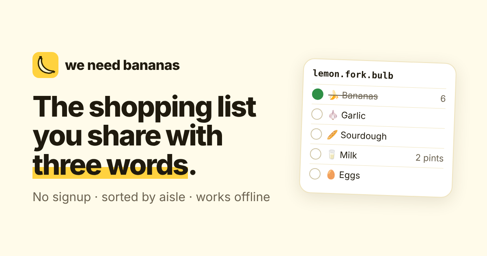

# weneedbananas

[](https://github.com/thomaschaplin/weneedbananas/actions/workflows/ci.yml) [](LICENSE)

[](https://weneedbananas.com)

A shared shopping list at **[weneedbananas.com](https://weneedbananas.com)** with no signup and no backend. A list is three random words (`weneedbananas.com/lemon.fork.bulb`); anyone with the words is on the list.

## How it works

- **No server stores lists.** Each device keeps the full list in IndexedDB ([Yjs](https://yjs.dev) CRDT + `y-indexeddb`).
- **Peer-to-peer sync.** Devices with the same list open connect over WebRTC via [Trystero](https://github.com/dmotz/trystero), using public Nostr relays for signaling only. The words go through PBKDF2 (600k rounds) on-device to produce the room id and the handshake password, so the relays never see the words or the items.
- **Optional password** (`src/lib/lock.ts`, `src/app/ListRoute.tsx`). A list can be given a password in its settings. Its contents then move to a second list whose keys come from the words, the password and a random salt (PBKDF2 again), and the list under the words alone keeps only that salt and the password list's public key, so a device can check a password without anything being sent. Each device remembers the password locally after it's typed once. Changing the password moves the list to a fresh salt and empties the old one; removing it copies everything back under the words alone. The words alone are only about 32 bits, so the password is what makes the relay copy hard to guess.
- **Passkeys for password lists** (`src/lib/passkey.ts`). With no server there's nothing for a passkey to log in to, so it's used for its [PRF extension](https://w3c.github.io/webauthn/#prf-extension) instead: the passkey turns a per-list input into a secret only it can reproduce, which (via HKDF) AES-GCM seals the list's password. The sealed copy is kept, by credential id, in the list under the words alone. Any device the passkey syncs to (iCloud Keychain, Google Password Manager, …) can then unseal the password and open the list without typing it. Each person adds their own; changing or removing the password drops them all, since they hold the old one. Browsers without PRF just don't show the option.
- **Encrypted mailbox for devices that aren't open together** (`src/lib/mailbox.ts`). Each device also publishes the whole Yjs state, AES-GCM encrypted with a key derived from the words, as a NIP-78 addressable event (kind 30078) on a few public Nostr relays, signed by a secp256k1 key also derived from the words. Relays keep only the newest one, and each carries a NIP-40 `expiration` 30 days out, refreshed whenever a device opens or edits the list. A device opening the list fetches it, merges it and republishes if it has anything new, and publishes again shortly after each edit and when the page is hidden. So someone can add items, lock their phone, and the next person to open the list still gets them. The UI shows sync state at all times.

## Shopping features

Auto aisle grouping (`src/lib/aisles.ts`) with a per-list aisle order, quantity parsing and duplicate merging (`src/lib/parse.ts`), a Shop mode (wake lock, big targets, progress), "couldn't find it", "done shopping" with undo, usuals, paste-a-recipe, "someone's at the shop" presence, "move to new words" (copies the list to fresh words and leaves only a "this list has moved" marker, without the new words, under the old ones; `src/lib/move.ts`), and offline PWA.

Plain text in and out (`src/lib/export.ts`): the share sheet can copy or send what's left to get as a message, grouped by aisle with the list link at the bottom. The installed PWA is a Web Share Target (`/share-target`, served by the list shell, `noindex`): text shared from another app (say, a recipe's ingredients) lands on a "which list?" chooser of recent lists or a new one, then waits in that list's add bar for you to confirm. The installed app's service worker answers `/share-target?text=…` from its cache; the page clears the query from the address bar before analytics loads (which strips queries and hashes anyway) and hands the text to the list in the URL hash, which browsers never send to a server.

## SEO / AEO / privacy

- `/`, `/how-it-works` and `/privacy` are prerendered at build time (`scripts/prerender.tsx`, run before the service worker is generated so its precache sees the final HTML) with JSON-LD (WebApplication, FAQPage, Article). `public/llms.txt`, `robots.txt` and `sitemap.xml` are included.
- `404.html` (served by Vercel for unknown paths, with a "did you mean this list?" hint) and `offline.html` (shown by the service worker when an uncached page can't load) are prerendered and `noindex`. The 404 reports itself to analytics as `/404` so a mistyped list name never leaves the device.
- List pages (`/word.word.word` → `list.html`) are `noindex` via meta tag **and** `X-Robots-Tag`, are disallowed in `robots.txt`, are excluded from the sitemap, and send `Referrer-Policy: no-referrer` (see `vercel.json`).

## Development

```sh
npm install
npm run dev        # http://localhost:5173/lemon.fork.bulb works in dev too
npm test           # unit tests (parser, aisles, slugs, CRDT merge)
npm run build      # typecheck + vite build + prerender
npm run test:e2e   # Playwright against the built site, incl. two-device WebRTC sync with a mock relay
npm run images     # regenerate icons and og.png
npm run format     # Prettier (format:check to verify only)
```

## Deploying

Import the repo into Vercel (framework preset: Vite). `vercel.json` sets the build, rewrites and headers. Then add the `weneedbananas.com` domain.

## Contributing

Issues and pull requests are welcome; see [CONTRIBUTING.md](CONTRIBUTING.md). Please report security problems privately, as described in [SECURITY.md](SECURITY.md).

## License

[MIT](LICENSE)
